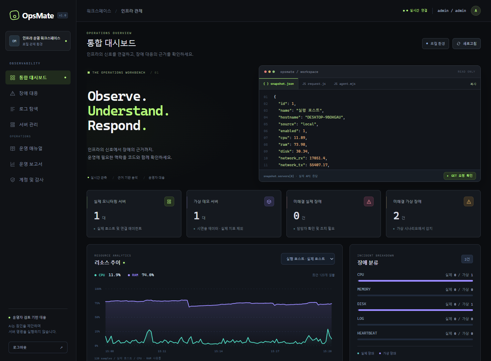

# OpsMate

AI 기반 실시간 IT 인프라 통합 관제 및 장애 대응 시스템입니다. 실행 호스트와 원격 에이전트의 실제 지표를 수집하고, 가상 데모 데이터를 별도 출처로 표시합니다. 장애 원인 가설과 운영 매뉴얼을 제시하며 서버 명령을 자동 실행하지 않습니다.



## 빠른 실행

Node.js **24.x**와 npm이 필요합니다. 테스트에 사용한 버전은 24.22.3입니다.

```powershell
cd 'E:\포트폴리오파일\최신통합본_20261126_122801\OpsMate'
npm ci --ignore-scripts
Copy-Item .env.example .env
npm run init
npm start
```

[로컬 관제 화면](http://127.0.0.1:3100)에 접속합니다. admin, operator, viewer의 서로 다른 초기 비밀번호는 `data/bootstrap.json`에서 확인합니다. 비밀번호를 화면 캡처·Git·제출 ZIP에 포함하지 마십시오. 초기화 스크립트는 기존 계정과 DB를 삭제하지 않습니다. 포트폴리오 패키지에는 실행 DB 대신 가상 데이터만 담은 `fixtures/demo.sqlite`를 제공합니다. 실행 전 `Copy-Item fixtures/demo.sqlite data/opsmate.sqlite`로 데모 템플릿을 사용할 수 있습니다. 이미 DB가 있다면 덮어쓰지 말고 먼저 백업하십시오.

`ADMIN_PASSWORD`를 초기화 전에 지정하면 admin에 적용합니다. 12자 이상이 필요합니다. 실행 중 변경은 `POST /api/password`에 현재 비밀번호와 새 비밀번호를 보내며 모든 기존 세션이 폐기됩니다. Windows에서는 `data` 폴더 ACL을 운영자 계정으로 제한합니다.

## 개발자 작업 공간

코드 편집기 형태의 패널에서 실제 서버 JSON, 복사 가능한 API 요청과 에이전트 연동 코드를 확인합니다. GET 요청 확인 버튼은 읽기 전용 조회만 수행합니다. 이벤트 스트림은 현재 브라우저가 수신한 HTTP·WebSocket 기록이며 서버 로그 원문과 구분합니다.

## 구현 기능

- HttpOnly 세션 쿠키, scrypt 해시, admin/operator/viewer 권한, 계정 생성과 역할 변경, 감사 로그
- 서버 등록·수집 활성/비활성, 서버별 토큰, 실제 CPU·RAM·디스크 및 네트워크 바이트/초 수집
- 인증 WebSocket 실시간 대시보드, 최근 120개 지표 추이, 출처별 장애 집계
- 원격 로그 수집·검색, CPU/RAM/Disk 임계치 및 ERROR 로그·수집 중단 감지
- 중복 장애 억제, 접수·확인·해결 상태와 처리 메모, 재발 이력
- 한국어 bigram BM25, 선택적 Ollama 임베딩 + RRF 검색, JSON 스키마 응답 및 인용 검증
- 모델 실패 시 원문 안내, 근거 없는 질의는 답변 보류, JSON 운영 보고서 다운로드

## 실제 데이터와 데모

| 출처 | 의미 | 제한 |
| --- | --- | --- |
| local | 이 Node 프로세스가 실행되는 호스트 | CPU는 이전 수집과의 차이, RAM은 OS 사용률, Disk는 작업 폴더 볼륨 |
| agent | 등록 토큰을 사용하는 원격 호스트 | 출처는 서버가 결정, 수집 시각은 서버 수신 시각 |
| demo | 프로그램이 만든 가상 서버 | 성능이나 실제 장애 증거로 사용하지 않음 |

네트워크는 RX/TX 바이트/초이며 링크 사용률과 다릅니다. 최초 샘플 및 수집 불가능한 값은 `null`로 표시합니다. Windows 네트워크 수집은 고정된 읽기 전용 PowerShell 명령을 사용합니다. Linux는 `/proc/net/dev`를 읽습니다. RAM은 메모리 압박 지표와 같지 않습니다. 임계치는 CPU 85%, RAM 90%, Disk 90%이며 단일 샘플 기준입니다. 실제 운영에는 지속시간·히스테리시스 튜닝이 필요합니다.

수집 주기는 이전 수집 완료 후 5초입니다. OS 조회·AI 요청 처리 시간만큼 실제 간격이 늘어날 수 있습니다. 지표와 로그는 7일 보존하며 장애·분석·감사 이력은 자동 삭제하지 않습니다. 통계는 화면의 최신 200건 범위와 운영 보고서의 전체 DB 집계를 구분합니다.

## 원격 에이전트

admin으로 서버 관리에서 `실제 에이전트`를 등록합니다. 한 번 표시되는 토큰을 해당 호스트 환경변수에 저장합니다.

```powershell
$env:OPSMATE_URL='https://관제서버주소'
$env:AGENT_TOKEN='등록화면에서발급한토큰'
$env:AGENT_LOG_PATH='C:\logs\application.log'
npm run agent
```

로컬 시연은 `http://127.0.0.1:3100`을 허용합니다. 원격 수집은 HTTPS만 허용합니다. 서버는 에이전트 호스트로 접속하거나 명령을 보내지 않습니다. 로그 파일은 시작 이후 추가된 내용을 최대 32KB·50줄씩 읽습니다. UTF-8 일반 텍스트만 지원합니다. 로테이션의 파일 크기 감소는 처리하지만 동일 크기 교체, 멀티바이트 경계, 재시도 영속 큐는 후속 과제입니다. 전송 실패 시 일부 로그가 유실될 수 있으므로 운영 로그 백업을 대체하지 않습니다. 민감정보는 수집 전에 마스킹하십시오.

## Ollama AI

로컬 Ollama가 실행 중이고 모델이 설치되어 있어야 합니다. 다음은 이 환경에서 확인한 모델입니다.

```powershell
ollama pull kanana2:3b
ollama pull embeddinggemma:latest
```

`.env`에서 `AI_ENABLED=true`로 바꾸고 서버를 재시작합니다. 기본 `OLLAMA_NUM_GPU=0`은 CPU 실행입니다. GPU 드라이버가 호환될 때만 변경합니다. 장애 상세에서 분석 버튼을 누릅니다. 모델/임베딩 타임아웃 시 BM25 및 원문 안내로 대체합니다. 원인 후보·확인 사항·대응은 매뉴얼에 등록된 항목으로 제한하고 매뉴얼에 없는 조치는 거부합니다. 문서 ID 검증은 사실 정확성 검증을 대신하지 않습니다. 운영자가 원인과 조치를 확인해야 합니다. AI는 실행 도구, shell, 삭제·재시작 API를 갖지 않습니다.

## DB 및 컨테이너

기본은 Node 내장 SQLite입니다. MariaDB 확장은 `DB_DRIVER=mariadb`와 별도 전용 데이터베이스의 `MARIADB_URL`을 사용합니다. 테이블은 자동 생성합니다. 기존 다른 프로젝트 DB를 사용하지 마십시오. SQLite와 MariaDB 간 자동 데이터 이관은 제공하지 않습니다. `deploy/mariadb-smoke.js`로 전용 빈 DB에서 별도 스모크 테스트를 수행할 수 있습니다.

```powershell
docker compose up --build -d
docker compose logs opsmate
docker compose exec opsmate cat data/bootstrap.json
node --env-file-if-exists=.env scripts/backup.js
```

Docker의 local 지표는 컨테이너가 노출하는 자원 관점이며 호스트 전체 관제를 원하면 호스트 에이전트를 사용합니다. 원격 공개 시 HTTPS 프록시가 필요합니다. 기본 서버는 루프백 주소에만 바인딩합니다. 분산 세션과 Redis는 이번 단일 인스턴스 구현 범위에 포함하지 않았습니다.

## 검증

```powershell
npm test
npm run evaluate
node scripts/evaluate-live.js
npm audit --omit=dev
```

단위·통합·API 테스트와 BM25 검색 평가는 CI에서도 실행합니다. 실제 모델 평가는 설치 모델과 하드웨어가 필요하므로 CI의 모의 모델 계약 테스트와 구분합니다. 평가 원본은 `evidence`에 있습니다. 15개 질의/5개 매뉴얼 평가는 소규모 자체 평가이며 현업 정확도가 아닙니다. 부하 테스트를 수행하지 않았으므로 TPS·동시 접속 한계·복구 시간 개선 수치를 주장하지 않습니다.

## 제출물과 구조

`src` 서버·저장소·인증·수집·RAG, `public` 관제 UI, `scripts` 초기화·에이전트·평가·백업, `test` 자동 테스트, `manuals` 예제 운영 매뉴얼, `fixtures` 공개용 가상 DB, `docs` 한국어 문서·도식·발표자료, `evidence` 실행 및 검증 증빙, `.github/workflows` Node.js 24 CI로 구성합니다. 문서 생성 도구는 `tools`에 두며 일반 앱 실행에는 필요하지 않습니다.

최종 기능 범위와 미검증 항목은 `docs/프로젝트결과보고서.md`와 `evidence/release-status.json`을 확인합니다. 자격 증명·실행 DB·node_modules는 Git과 제출 ZIP에서 제외합니다.

최종 로컬 자동 테스트는 28개 통과, 실제 에이전트 지표·파일 로그 수집과 SQLite 템플릿 초기화·백업을 검증했습니다. 전용 Docker 앱 내부 HTTP와 MariaDB 11.4의 통합 검사 9개도 통과했습니다. 이 환경에서 Windows 호스트의 Docker 공개 포트 접속은 확인하지 못했습니다. 로컬 Node 실행 화면과 컨테이너 내부 검증을 구분합니다. 자세한 원본은 `evidence/docker-mariadb-check.json`에 있습니다.

## 코드를 읽는 순서

각 파일의 맨 위에는 역할과 처리 순서를, 주요 함수 앞에는 목적·입력·반환값·예외 또는 설계 이유를 한국어로 설명했습니다. `@param`과 `@returns`는 편집기에서 함수 사용법을 볼 때도 참고할 수 있습니다.

| 순서 | 파일 | 확인할 내용 |
| --- | --- | --- |
| 1 | [scripts/init.js](scripts/init.js) | 최초 실행에서 무엇을 만들고 무엇을 보존하는지 |
| 2 | [src/db.js](src/db.js), [src/seed.js](src/seed.js) | DB 인터페이스와 초기 계정·서버 생성 |
| 3 | [src/security.js](src/security.js) | 비밀번호 해시, 토큰 해시, 세션 쿠키의 차이 |
| 4 | [src/telemetry.js](src/telemetry.js), [scripts/agent.js](scripts/agent.js) | 실제 지표 단위, 이전 측정값, 미수집 null, 로그 전송 한계 |
| 5 | [src/incidents.js](src/incidents.js) | 임계치 분류와 미해결 장애 중복 억제 |
| 6 | [src/rag.js](src/rag.js) | BM25·임베딩·RRF와 원인 후보/인용 검증, 실패 대체 경로 |
| 7 | [src/server.js](src/server.js) | API별 인증·권한·입력 검사, WebSocket과 수집 루프 |
| 8 | [public/app.js](public/app.js), [public/developer.js](public/developer.js) | 화면 갱신, 안전한 텍스트 출력, 실제 JSON·코드 탭 |

`test`는 동작을 어떻게 검증하는지, `tools`는 실행 화면과 제출물을 어떻게 만들고 검사하는지 읽는 영역입니다. Docker와 CI 설정에도 실행 범위와 각 단계의 이유를 적었습니다. 주석만 바뀌었는지는 `evidence/comment-review.json`의 실행 구문 동일성 검사 결과에서 확인할 수 있습니다.

## 기술 근거

- [Node.js 24 SQLite 공식 문서](https://nodejs.org/download/release/latest-v24.x/docs/api/sqlite.html)
- [Ollama 임베딩 API](https://docs.ollama.com/api/embed)
- [Ollama 구조화 출력](https://docs.ollama.com/capabilities/structured-outputs)
