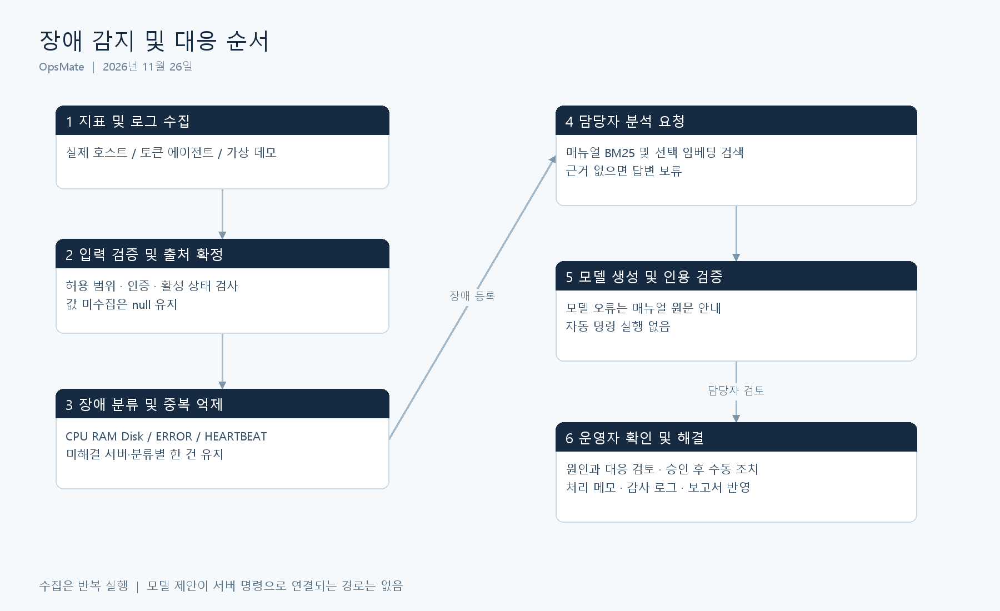

# OpsMate 순서도

수집부터 감지와 담당자 처리까지의 흐름을 설명한다. 모델 출력은 운영 제안이며 자동 실행 단계가 없다.

## 전체 처리 흐름

## 예외와 상태 전이

수집 인증·범위·JSON 검사에 실패하면 요청을 거부한다. 로컬 수집 미지원 값은 null로 유지한다. 동일 서버·분류의 기존 미해결 장애가 있으면 신규 행을 만들지 않는다.

검색 결과가 없으면 답변을 보류한다. 임베딩 실패는 BM25로 진행하며 모델 통신·스키마·인용 검증 실패는 매뉴얼 원문 안내로 대체한다. 이 대체 응답을 모델 분석 성공으로 집계하지 않는다.

운영자는 접수된 장애를 확인하거나 직접 해결할 수 있다. 해결한 장애를 다시 접수 상태로 되돌리는 API는 없다. 재발 시 새로운 장애 ID와 처리 이력을 생성한다.

## 시연 절차

초기화 후 로그인한다. 실제 호스트 지표가 수집되고 데모 서버의 DISK 장애가 생성되는지 확인한다. 가상 배지를 확인한 뒤 장애 상세에서 원문 매뉴얼 안내를 연다.

AI를 활성화한 환경에서는 가설·확인 사항·승인 후 대응과 참고 문서를 함께 읽는다. 조치 내용은 담당자가 직접 검토하고, 실제 수행한 내용과 확인 결과만 메모에 기록한다.
