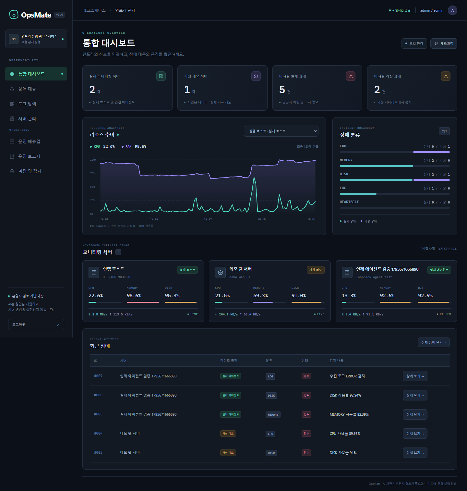

# OpsMate 테스트결과서

Node.js 24.22.3에서 단위·API·통합 및 모의 Ollama 계약 테스트를 실행했다. 실제 브라우저와 실제 로컬 모델의 증빙은 자동 테스트 결과와 구분한다.

## 자동 테스트 결과

최종 자동 검사 수와 실패 건수는 evidence/test-output.txt 원본을 기준으로 확인한다. 초기 SQL 바인딩 개수 오류는 수정 후 전체 재검증했다. 로컬 네트워크가 차단된 샌드박스 실행은 테스트 성공 근거로 사용하지 않았다.

| 분류 | 검증 내용 | 증빙 |
| --- | --- | --- |
| 단위 | 해시·임계치 경계·중복·실제 수집·검색 | test/unit.test.js |
| API·통합 | 인증·RBAC·수집·상태·감사·WS | test/api.test.js |
| AI 계약 | 정상·허위 인용·접속 실패 대체 | test/ai.test.js |
| 의존성 | npm audit 런타임 취약점 0건 | evidence/npm-audit.json |

## 검색 및 모델 평가

수동 작성한 질의 15개와 자체 매뉴얼 5개에서 BM25 Top1은 93%, Recall@3은 100%였다. 무관 질의 1개는 답변 보류를 확인했다. 동일 작성자의 소규모 질의이므로 독립 데이터나 실운영 정확도를 뜻하지 않는다.

실제 Ollama 평가 모델은 kanana2:3b와 embeddinggemma:latest다. 최종 3개 질의 중 모델 응답 계약을 통과한 수는 3/3다. 임베딩은 CPU 실행으로 CUDA 호환 문제를 피했다. 모델 응답의 근거 포함 여부와 의미 타당성은 별개다.

실제 모델 응답 원문과 개별 소요 시간은 evidence/ai-live-evaluation.json에 보존한다. 소요 시간은 3개 개별 호출 값이며 평균 서비스 성능, 처리량, 동시성 보장으로 해석하지 않는다. 모델 응답은 사람의 내용 검토가 필요하다.

## 브라우저 검증

Chrome headless에서 로그인·대시보드·장애 원문 분석·로그·계정 화면을 확인했다. 캡처는 6개이고 pageerror는 0건이다. 390×844 화면에서 문서 전체 가로 넘침은 False였다.

자동 캡처는 기능 접근과 렌더 결과를 확인한 것으로 모든 브라우저·장애인 접근성·모든 화면 조합의 완전 검증을 뜻하지 않는다.

## 검증 한계와 후속 검사

실제 장애 정답 데이터, 장시간 부하, 다중 인스턴스, 자동 복구, 원격 TLS 프록시, 대규모 로그 및 파일 로테이션 유실률은 측정하지 않았다.

전용 Docker 앱 내부 HTTP와 MariaDB 11.4에서 로그인·서버·수집·감지·분석 저장·해결·로그 검색·보고서·감사 9개 통합 검사를 통과했다. Windows 호스트의 Docker 공개 포트 접속은 확인하지 못했다. 내부 기능 검증을 외부 접속 및 운영 배포 완료로 표시하지 않는다.
