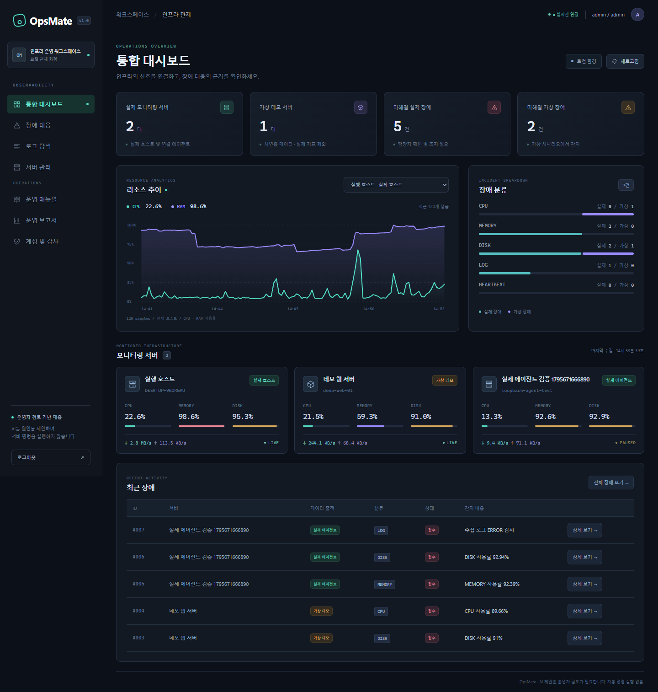
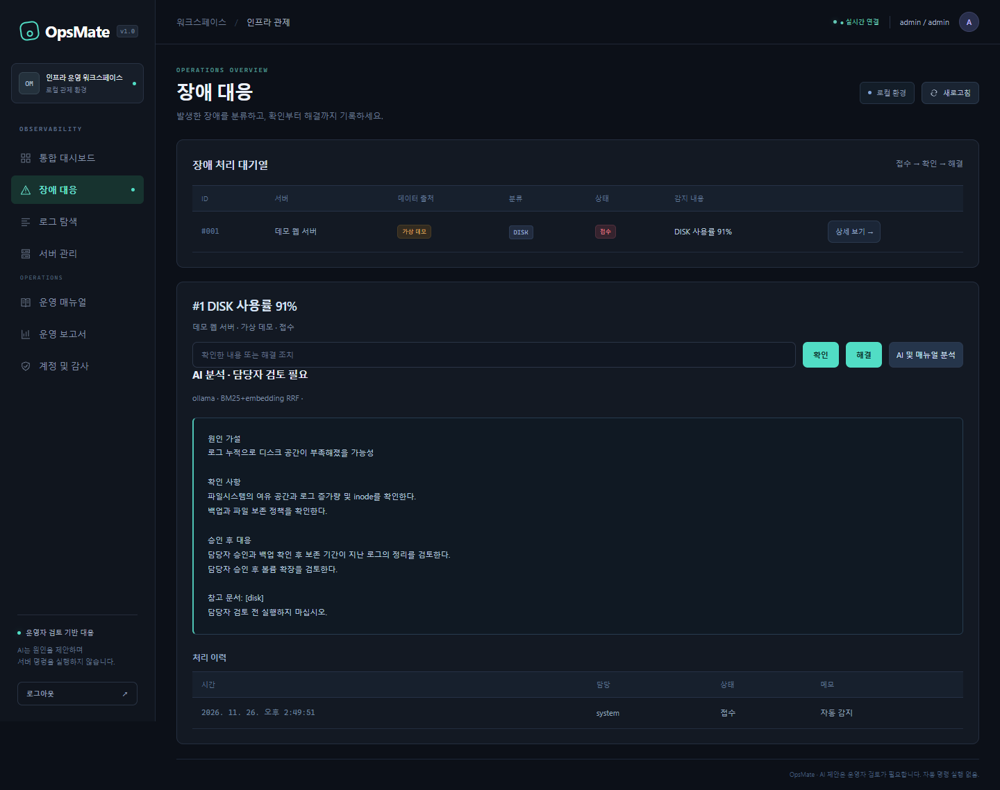

# OpsMate 포트폴리오

OpsMate는 실제 시스템 지표와 가상 장애를 구분한 관제 화면, 역할 기반 운영 절차, 매뉴얼 근거 검색과 로컬 AI 응답 검증을 구현한 프로젝트다. 이 자료는 구현 범위와 실행 증빙을 중심으로 구성한다.

## 핵심 구현과 설계 결정

별도 프런트엔드 빌드 없이 HTML·CSS·JavaScript로 화면을 구성하고 Node.js 24와 SQLite로 실행한다. 서버 등록 시 발급한 토큰은 실제 에이전트만 사용하며 DB에는 해시를 저장한다.

단일 샘플 임계치 감지를 출발점으로 삼고 active_key 유일 제약으로 중복 장애를 억제했다. 처리 상태와 메모는 별도 이벤트로 남겨 누가 언제 처리했는지 확인할 수 있다.

AI는 모델 존재 여부에 의존하지 않는 BM25 검색을 기본으로 하고 임베딩·생성·인용 검증을 단계적으로 적용한다. 생성 실패는 원문 안내로 표시한다.

## 실제 실행 관제 화면

실행 호스트는 실제 수집값, 데모 웹 서버는 가상 데이터다. 서버·장애 통계의 출처를 나누며 수집할 수 없는 네트워크 값은 0으로 만들지 않는다.

## 장애 분석과 대응 기록

격리된 가상 DISK 장애에 실제 Ollama 모델 분석을 요청한 화면이다. 원인 후보·확인 사항·승인 후 대응을 매뉴얼에 등록된 항목에서 선택하고 참고 문서를 표시한다. 서버 명령 실행 경로는 없다.

## 검증 결과와 개선 방향

Node.js 24 자동 테스트와 Chrome UI 검증을 수행했다. 자체 검색 질의 15개에서 Top1 93%를 측정했지만 현업 검색 정확도로 일반화하지 않는다. 실제 모델 응답 계약 통과는 최종 평가 3/3다.

의존성 보안 점검 후 알려진 취약점이 없는 버전으로 갱신했다. Docker 앱 내부와 MariaDB 11.4의 통합 검사 9개를 통과했다. 후속 과제는 Windows Docker 호스트 접속, 지속시간 기반 감지, 에이전트 재전송 큐, 독립 장애 데이터 평가와 장시간 부하 검사다.

본 자료는 프로젝트 구현을 설명한다. 사용자 개인의 경력, 소속, 현업 성과, 팀 기여율 또는 저자 이름을 추정해 기재하지 않았다.
