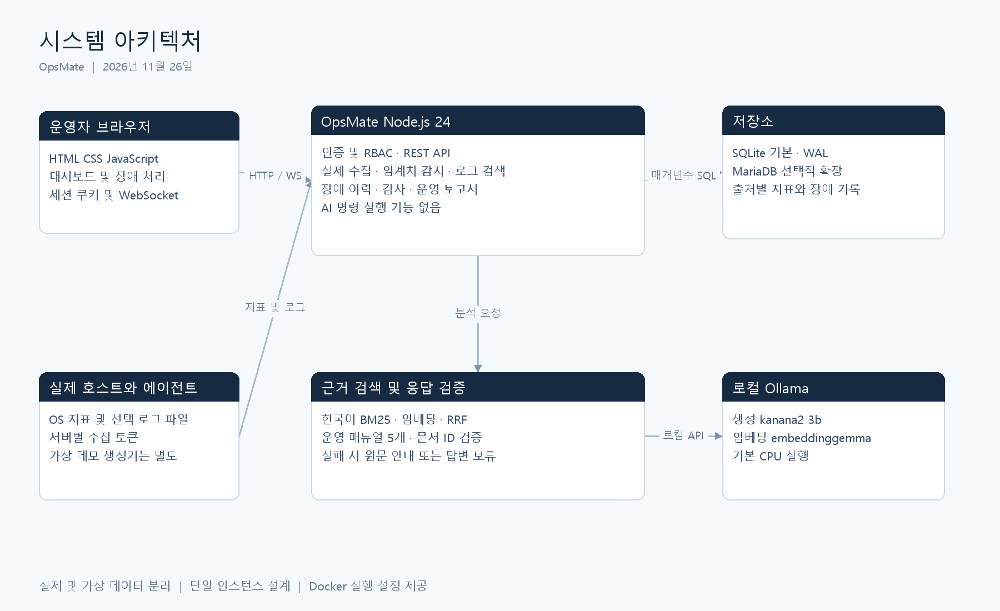

# OpsMate 프로젝트기획서

OpsMate는 단일 PC에서 재현할 수 있는 관제 데모를 우선 제공하고, 실제 원격 수집과 로컬 AI 연동을 확장 가능한 구조로 묶는 프로젝트다.

## 프로젝트 목표

서버 상태 확인에서 장애 탐지, 매뉴얼 검색, 담당자 처리 기록까지 하나의 흐름을 구현한다. 관리자·운영자·조회자의 업무 범위를 구분하고 변경 이력을 추적한다.

핵심 시연은 실제 실행 호스트 관제와 가상 디스크 장애를 함께 보여 주되 출처를 명확히 표시하는 것이다. 모델이 없거나 응답 검증에 실패해도 원문 매뉴얼로 운영자가 확인을 이어갈 수 있어야 한다.

## 기술 구성과 선택 이유

| 계층 | 기술 | 선택 이유 |
| --- | --- | --- |
| 화면 | HTML CSS JavaScript | 별도 빌드 없이 실행·외부 CDN 불필요 |
| 서버 | Node.js 24 HTTP·ws | API와 실시간 스트림 통합 |
| 저장소 | SQLite / MariaDB 어댑터 | 간편한 데모와 DB 확장 |
| AI | Ollama BM25 임베딩 RRF | 로컬 모델과 근거 검색 |
| 운영 | Docker GitHub Actions | 재현 가능한 실행 및 자동 검사 |

## 시스템 구성

브라우저는 API와 인증 WebSocket을 사용한다. 에이전트는 서버별 토큰으로 지표와 로그를 푸시한다. AI 응답은 실행 경로와 연결하지 않으며 담당자가 승인한 조치를 시스템 밖에서 수행한다.

## 범위 및 위험 관리

실제 지표는 OS·권한에 따라 일부 수집하지 못할 수 있다. null과 수집 지연을 그대로 표시한다. 단일 샘플 감지는 오탐에 민감하므로 후속 운영 튜닝에서 지속시간과 히스테리시스를 도입한다.

AI는 근거 ID가 유효해도 잘못된 원인을 제시할 수 있다. 문서 검색 평가와 모델 응답 계약 평가를 분리하고 실제 현장 장애 정확도는 주장하지 않는다.

배포 환경, 방화벽, TLS, 백업 보존, 개인정보 로그 처리, 계정 복구 및 장시간 안정성은 운영 전 별도 검증해야 한다.
